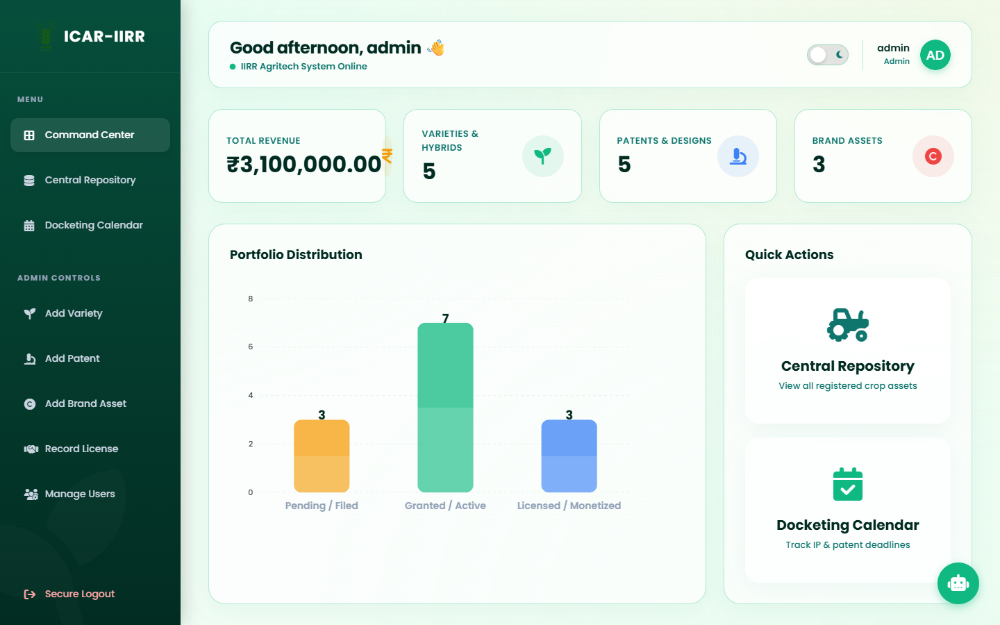
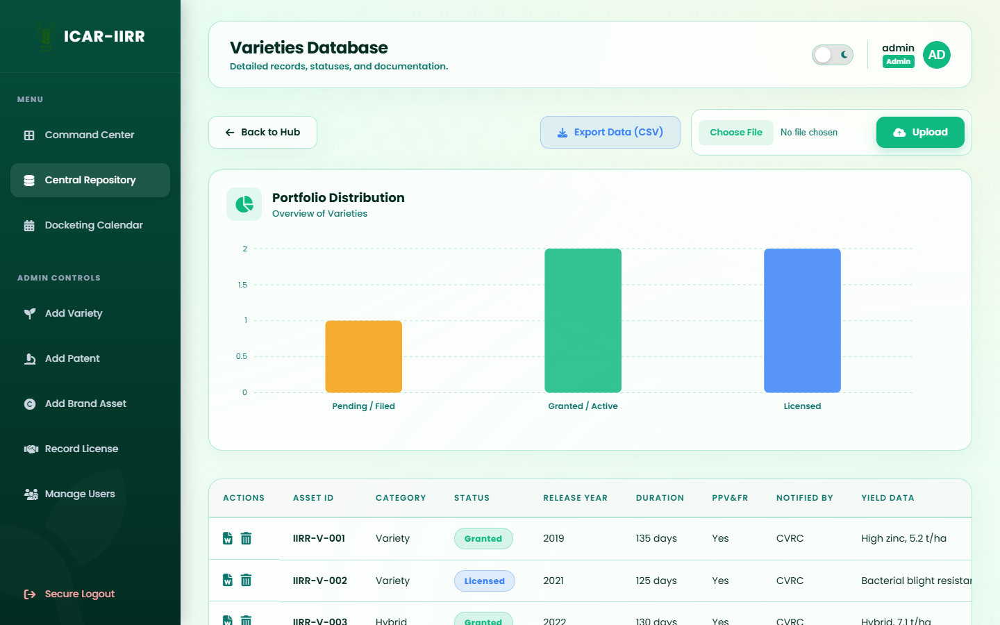
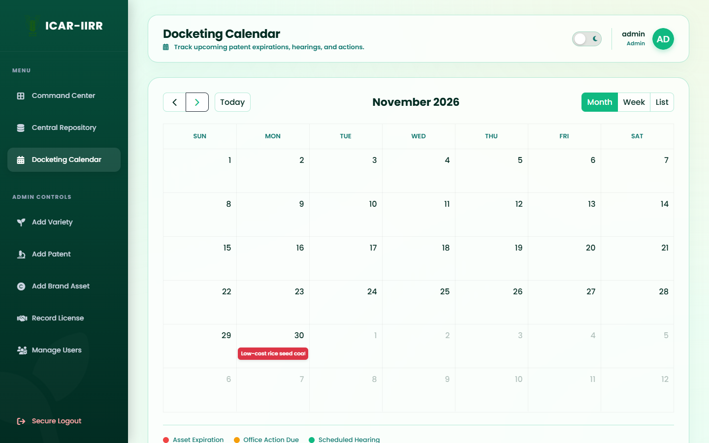
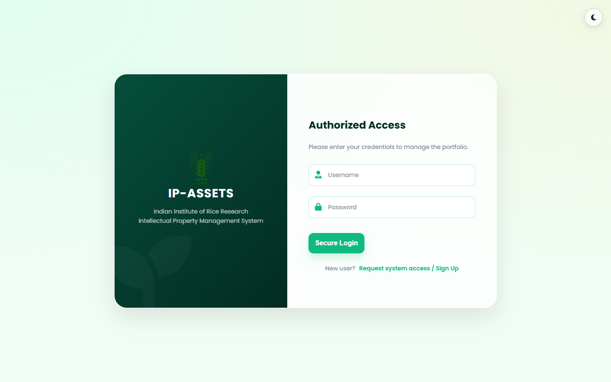

<div align="center">

# 🌾 ICAR-IIRR IP Management Portal

**A secure web portal for tracking intellectual-property assets, licenses and deadlines at the ICAR-Indian Institute of Rice Research.**


</div>

---

## 📸 Screenshots



| Varieties repository | Docketing calendar |
| --- | --- |
|  |  |

<p align="center"></p>

## ✨ Features

| Area | What it does |
| --- | --- |
| 🔐 **Secure login** | Password login followed by a 6-digit PIN emailed to the user (2FA); OTPs are kept server-side |
| 👥 **Roles & approvals** | Admin and Scientist roles; new sign-ups stay pending until an admin approves them (approval email sent automatically) |
| 🗂️ **Central repository** | Plant varieties & hybrids, variety licenses, product / process / design patents, copyrights and trademarks |
| 💰 **Revenue tracking** | Dashboard totals license fees and royalties in real time |
| 📅 **Docketing calendar** | FullCalendar view of grant dates and expiry deadlines, colour-coded |
| 📊 **Analytics** | Chart.js breakdown of the portfolio and Filed / Granted / Licensed status counts |
| 📥 **Bulk CSV** | One-click CSV export per asset type, and CSV import with duplicate prevention |
| 📄 **Certificates** | Download a Word (.docx) certificate for any asset |
| 🤖 **AI assistant** *(optional)* | Gemini-powered chat widget that answers questions about the database, plus per-asset AI insights |

## 🛠️ Tech stack

- **Backend:** Python, Flask, Flask-SQLAlchemy, Flask-Login, Flask-Mail
- **Database:** SQLite
- **Frontend:** Jinja2 templates, HTML, CSS, JavaScript, Chart.js, FullCalendar
- **Documents & AI:** python-docx, Google Gemini (`google-genai`)

## 🚀 Getting started

**1. Clone and install**

```bash
git clone https://github.com/suhas107/IP-MANAGEMENT-portal.git
cd IP-MANAGEMENT-portal
python -m venv venv
venv\Scripts\activate          # macOS/Linux: source venv/bin/activate
pip install -r requirements.txt
```

**2. Configure.** Copy `.env.example` to `.env` and fill it in:

| Variable | Purpose |
| --- | --- |
| `MAIL_USERNAME` / `MAIL_PASSWORD` | Gmail address and [app password](https://support.google.com/accounts/answer/185833) used to send 2FA PINs |
| `SECRET_KEY` | Any long random string |
| `ADMIN_EMAIL` / `ADMIN_PASSWORD` | Credentials for the first admin account |
| `GEMINI_API_KEY` | *Optional.* Enables the AI assistant; the app runs fine without it |

**3. Run**

```bash
python app.py
```

Open **http://127.0.0.1:5000/setup** once to create the database and admin account, then log in at **/login** with username `admin`.

## 📁 Project structure

```
IP-MANAGEMENT-portal/
├── app.py              # Flask app: models, routes, auth, CSV, AI chat
├── requirements.txt
├── .env.example
├── static/             # logos and uploads
└── templates/          # dashboard, repository, forms, calendar, auth pages
```

## 📄 License

[MIT](LICENSE)
